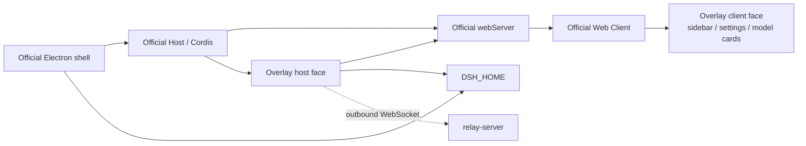

# Architecture Notes

For developers changing `overlay/` or `scripts/`. Repository structure and dependency direction live in [official shell and overlay](official-architecture.md); this page explains how the overlay attaches to the official desktop and what packaging does to the disposable staging tree.

## One product, two code layers

| Layer | Owner | Editable? |
|---|---|---|
| Official desktop `apps/desktop`, `packages/**` | [deepseek-ai/deepseek-harness](https://github.com/deepseek-ai/deepseek-harness), checked out into the gitignored `deepseek-harness/` | No. All adaptation happens in staging |
| Overlay `overlay/` | This repository | The only product code we own |
| Packaging and sync `scripts/` | This repository | Yes, but do not bypass existing guards |
| Relay `relay-server/` | This repository | Deployed separately, not shipped in the app |

Runtime topology:



## How the overlay is loaded

Three declarations must agree; dropping any one breaks loading:

1. **Package declaration** in `overlay/package.json`:

```json
{
  "dsh": {
    "bundle": { "patch": "./cordis.patch.yml" },
    "client": {
      "inject": [
        "@deepseek-ai/dsh-client-ui-sidebar",
        "@deepseek-ai/dsh-client-ui-settings",
        "@deepseek-ai/dsh-client-ui-settings-models"
      ],
      "platform": "web"
    }
  }
}
```

`exports` maps `.` to the host bundle `lib/index.js` and `./client` to the browser bundle `lib/client.js`.

2. **Profile patch**: `overlay/cordis.patch.yml` inserts one row into the official desktop profile:

```yaml
- insert:
    - id: overlay-custom
      name: dsh-overlay-custom
```

3. **Profile composition**: the target profile's `package.json` lists the overlay package in `dsh.profile.bundles` and can resolve it as a dependency. Development uses a `file:` dependency; the portable build swaps in the staged `@deepseek-ai/dsh-overlay-custom` (see "Profile repair" below).

The host face (`overlay/src/index.ts`) declares `name = 'dsh-overlay-custom'` and `inject = ['webServer', 'connection']`. `apply()` mounts, in order: the model-network API (returning one `ModelProxyManager` reused by later modules), the relay, model tooling, OAuth, the Skills/MCP routes, and finally the enabled MCP clients.

The client face (`overlay/src/client/index.ts`) declares `inject = ['slots', 'locale']` and registers into these official slots:

| Slot | Content | id |
|---|---|---|
| `sidebar.footer.action` | Sidebar "Mobile" entry and pairing dialog | `overlay-remote` |
| `settings.section` | Settings page "Skills" | `overlay-skills` (order 90) |
| `settings.section` | Settings page "MCP" | `overlay-mcp` (order 95) |
| `settings.models.provider-card` | Per-card test, fetch/select, OAuth sign-in | two registrations |
| `settings.models.footer` | "Model network" proxy panel | `overlay-model-proxy` |

## Host contract

- **Required**: `webServer` (`register({ kind: 'exact' | 'prefix', path, handler })`, returns a disposer) and `connection` (`requestRejection`, `authenticatedUrl`, `authorizeIndex`). If either is missing the overlay does not start; the official desktop keeps running.
- **Optional, probed on use**: `authorization` (`ctx.get('authorization')`; when absent, OAuth reports unavailable), `skills` and `agentPresets` (when absent, the Skills page reports that the composition has no skill catalog).
- **Events**: `llm/stream` routes model requests through the overlay's network route; `approval/request` and `user-questions/request` are mounted with `prepend` so the phone can answer first while the desktop still works.
- **Hard rule**: the overlay must never become a boot dependency. A missing or renamed official service may only degrade the corresponding entry point, never fail desktop startup.

## Data and state

- The active home is resolved by `overlay/src/dsh-home.ts`: `DSH_HOME` if set, otherwise `~/.dsh`. The overlay imports no official home-paths package and never guesses profile paths.
- All overlay state is `<DSH_HOME>/overlay-custom.yaml` (mode `0600`): `remoteRelayOrigin`, `mcpServers`, `modelProxyMode` / `modelProxyUrl` / `modelProxyBypass`. The official `settings.yaml` is not written.
- One deliberate exception: model selection has to reach the official loader, so it is written into the `llm-pi-ai` row of the profile's `cordis.patch.yml`; reads merge the user layer from `settings.yaml`.
- Credentials are read-only: OAuth credentials come from `<DSH_HOME>/.credentials.yaml` under `llm-pi-ai/openai-codex` and `llm-pi-ai/xai`. The overlay never writes credentials.

## Official version lock

`official-lock.json` is the single source of the baseline: `repository`, `commit`, `version` (currently `0.2.1-rc.5`, commit `b830ec95`).

- `scripts/check.sh` compares `deepseek-harness/` `HEAD` and `package.json` version against the lock and requires a clean checkout.
- Both portable build scripts run the same check before packaging and re-confirm afterwards that the official tree did not change.
- Changing the baseline is limited to fast-forwarding to a published official tag and re-running a complete portable build plus smoke. Never patch or cherry-pick local features into the official tree.

## Portable packaging pipeline

```text
overlay: npm ci → bundle:host → bundle:client → check
staging: git archive HEAD (disposable official tree)
prepare-portable-stage.mjs: inject overlay + packaging adaptations
pnpm install --no-frozen-lockfile
apps/desktop run package -- <target> --unsigned --dir --build-version <v>
ASAR: extract → sanitize → repack (native unpacked files preserved)
verify-portable-paths → finalize-portable-runtime → smoke-portable-final
dist/: artifacts + .sha256 + .build.json
```

| Script | Responsibility |
|---|---|
| `prepare-portable-stage.mjs` | Copies the overlay to `packages/external/overlay-custom`, renames it to `@deepseek-ai/dsh-overlay-custom`, aligns its version with the official one, and writes every packaging adaptation |
| `sanitize-portable-paths.mjs` / `verify-portable-paths.mjs` | Scrub build-host absolute paths; after repacking, prove no local path or source-directory symlink remains |
| `repack-portable-asar.mjs` | Extract, sanitize, and repack the ASAR while preserving electron-builder's native unpacked files and their integrity digest |
| `finalize-portable-runtime.mjs` | Audit the permitted post-packaging changes, write the final `desktop-runtime.json`, and update Windows ASAR integrity |
| `smoke-portable-final.mjs` | Run the official smoke against the **final** artifacts, not the staging tree |
| `write-portable-metadata.mjs` | Emit `.sha256` and `.build.json` |

Every adaptation lives in `prepare-portable-stage.mjs`, applies only to staging, and never flows back into the official tree. Current adaptations:

- Inject `apps/desktop/src/portable-overlay-profile.ts` and call it whenever the desktop creates or upgrades a profile (next section).
- Default the portable home to `~/.dsh-official` when `DSH_HOME` is unset.
- Verify the client bundle's module identity (`window.__ModuleLoader__.load({id:<package name>})`) matches the package name.
- Strip the `NODE_PATH` block from pnpm shims and scrub build-host paths from the runtime tree.
- Allow unsigned macOS arm64 packaging, skip signing and notarization, and ad-hoc re-sign.
- Models: pin the pi-ai adapter to `transport: 'sse'` (each call follows the route captured for that call), and keep Bedrock on HTTP/1 by injecting `overlay/patches/pi-ai-bedrock-http1.fragment` into the official patch.
- Attachments: drop the catalog modality preflight before images and surface the real failure reason instead.
- Write `apps/desktop/.env.windows` / `.env.macos` with app id `com.deepseek.harness.overlay.local`.

### Profile repair (`file:` dependencies)

In a portable build the overlay is a baked-in workspace package, not a source directory, so development-time `file:` dependencies and symlinks must not survive. `reconcilePortableOverlayProfile()` runs idempotently on every profile create/upgrade and:

1. removes `dsh-overlay-custom` and `@deepseek-ai/dsh-overlay-custom` from `dependencies`;
2. keeps other bundles in `dsh.profile.bundles`, drops legacy overlay rows, and appends the current package name;
3. strips legacy overlay rows from `cordis.patch.yml` while keeping other patches, and fixes the image-input declaration of already-selected GPT/Grok models;
4. deletes the leftover `node_modules/dsh-overlay-custom` symlink and any `package-lock.json` mentioning the legacy name;
5. writes `portable-overlay-state.json` to record the repair.

User bundles, patch rows, and `settings.yaml` are left alone.

## Artifacts and release

| Platform | Artifacts |
|---|---|
| Windows x64 | `deepseek-harness-overlay-<v>-win-x64-unsigned-manual.exe` (NSIS) and `...zip` (portable directory) |
| macOS arm64 | `deepseek-harness-overlay-<v>-mac-arm64-adhoc-manual.dmg` and `...zip` |

Every artifact gets a matching `.sha256` and `.build.json` recording `officialCommit`, `officialVersion`, `buildVersion`, `overlayHash`, `sha256`, `platform`, `arch`, `signing`, and `update: manual`. That is six files per platform and twelve attachments per release.

`buildVersion` must begin with the locked official version; the default is `<official version>.<yyyyMMdd>.1`, overridable with `DSH_PORTABLE_BUILD_VERSION`.

Releases use [release-official-portable.yml](../.github/workflows/release-official-portable.yml): `workflow_dispatch` takes `build_version`, `release_tag` (must equal `official-v<build_version>`), and `publish`. It creates a draft prerelease, and only after both platform jobs pass does it verify all twelve attachments and publish.

## Local development and verification

```bash
bash scripts/bootstrap.sh          # first clone of the official checkout
DSH_OFFICIAL_REF=dsh-v0.2.1-rc.5 bash scripts/update-official.sh   # fast-forward to a published tag and build
bash scripts/start-official.sh     # run the official desktop with ~/.dsh-official-dev, logs beside it
bash scripts/install-overlay.sh    # install the overlay into the dev profile via file:
bash scripts/check.sh              # unit tests + script syntax + lock consistency
```

`install-overlay.sh` refuses to rewrite a desktop profile managed by the official Electron app; such a profile only accepts `file:<repo>/overlay` through the official plugin manager.

```bash
cd overlay && npm ci && npm run bundle:host && npm run bundle:client && npm run check
cd .. && node --test scripts/test-finalize-portable-runtime.mjs scripts/test-repack-portable-asar.mjs
```

Portable builds run on their target platform:

```powershell
pwsh -NoProfile -File scripts/build-portable-windows-x64.ps1
```

```bash
bash scripts/build-portable-macos-arm64.sh
```

The CI overlay job checks out no official sources, so green unit tests only prove the overlay is self-consistent. A build is verified only after one real build plus smoke on Windows x64 and macOS ARM64.

## Further reading

- [Official shell and overlay](official-architecture.md): division of labor and hard rules
- [Overlay plugin development](plugin-development.en.md): how to add a new capability path
- [Plugin ecosystem and this repository](plugin-ecosystem.en.md): overlay versus official plugins
