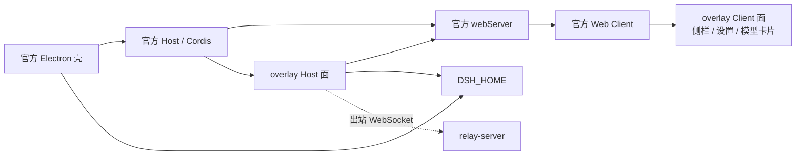

# 架构说明

面向要改 `overlay/` 或 `scripts/` 的开发者。仓库结构与依赖方向见[官方壳与 overlay 架构](official-architecture.md)；本篇说明 overlay 具体怎么接进官方桌面，以及打包时对一次性 staging 做了什么。

## 一个产品，两层代码

| 层 | 归属 | 是否可改 |
|---|---|---|
| 官方桌面 `apps/desktop`、`packages/**` | [deepseek-ai/deepseek-harness](https://github.com/deepseek-ai/deepseek-harness)，检出在 gitignored 的 `deepseek-harness/` | 不改。所有适配只在 staging 里做 |
| overlay `overlay/` | 本仓库 | 唯一自研产品代码 |
| 打包与同步 `scripts/` | 本仓库 | 可改，但不要绕过既有校验 |
| 中继 `relay-server/` | 本仓库 | 独立部署，不随桌面包发布 |

运行时拓扑：



## overlay 如何被加载

三处声明互相对应，缺一不可：

1. **包声明** `overlay/package.json`：

```json
{
  "dsh": {
    "bundle": { "patch": "./cordis.patch.yml" },
    "client": {
      "inject": [
        "@deepseek-ai/dsh-client-ui-sidebar",
        "@deepseek-ai/dsh-client-ui-settings",
        "@deepseek-ai/dsh-client-ui-settings-models"
      ],
      "platform": "web"
    }
  }
}
```

`exports` 把 `.` 指向 Host 包 `lib/index.js`，把 `./client` 指向浏览器包 `lib/client.js`。

2. **profile patch** `overlay/cordis.patch.yml` 向官方 desktop profile 追加一行：

```yaml
- insert:
    - id: overlay-custom
      name: dsh-overlay-custom
```

3. **profile 组合** 目标 profile 的 `package.json` 中 `dsh.profile.bundles` 含 overlay 包名，且依赖能解析到它。开发时用 `file:` 依赖；便携包里换成打进 staging 的 `@deepseek-ai/dsh-overlay-custom`（见下文「profile 修补」）。

Host 面 `overlay/src/index.ts` 声明 `name = 'dsh-overlay-custom'`、`inject = ['webServer', 'connection']`，`apply()` 依次挂载：模型网络 API（返回一个 `ModelProxyManager`，供后续模块复用）、中继、模型工具、OAuth、Skills/MCP 路由，最后挂载已启用的 MCP 客户端。

Client 面 `overlay/src/client/index.ts` 声明 `inject = ['slots', 'locale']`，注册到这些官方插槽：

| 插槽 | 内容 | id |
|---|---|---|
| `sidebar.footer.action` | 侧栏「手机连接」入口与配对弹窗 | `overlay-remote` |
| `settings.section` | 设置页「技能」 | `overlay-skills`（order 90） |
| `settings.section` | 设置页「MCP」 | `overlay-mcp`（order 95） |
| `settings.models.provider-card` | 模型卡片内的测试连接、拉取/勾选、OAuth 登录 | 两个注册项 |
| `settings.models.footer` | 模型页底部「模型网络」 | `overlay-model-proxy` |

## Host 侧契约

- **必需**：`webServer`（`register({ kind: 'exact' | 'prefix', path, handler })`，返回 dispose）与 `connection`（`requestRejection`、`authenticatedUrl`、`authorizeIndex`）。二者之一缺失时 overlay 不启动，官方桌面照常运行。
- **可选、按需探测**：`authorization`（`ctx.get('authorization')`，缺失时 OAuth 显示不可用）、`skills` 与 `agentPresets`（缺失时技能页显示"当前组合未挂载技能目录"）。
- **事件**：`llm/stream` 用于把模型请求接到 overlay 的网络路由；`approval/request`、`user-questions/request` 以 `prepend` 方式挂载，让手机端可以抢先应答，桌面仍可正常回答。
- **硬规则**：overlay 不得成为启动依赖。任何官方服务缺失或改名，只能让对应入口降级，不能让官方桌面启动失败。

## 数据与状态

- 当前 home 由 `overlay/src/dsh-home.ts` 自行解析：`DSH_HOME` 优先，否则 `~/.dsh`。overlay 不 import 官方的 home-paths 包，也不猜 profile 路径。
- overlay 的所有持久状态都在 `<DSH_HOME>/overlay-custom.yaml`（`mode 0600`）：`remoteRelayOrigin`、`mcpServers`、`modelProxyMode` / `modelProxyUrl` / `modelProxyBypass`。**不写官方 `settings.yaml`**。
- 例外是设计使然：模型勾选要影响官方 Loader，所以写入 profile 的 `cordis.patch.yml` 中 `llm-pi-ai` 行；读取时会与 `settings.yaml` 的用户层合并。
- 凭据只读：OAuth 凭据从 `<DSH_HOME>/.credentials.yaml` 读取 `llm-pi-ai/openai-codex`、`llm-pi-ai/xai`，overlay 不写凭据。

## 官方版本锁定

`official-lock.json` 是唯一基线来源：`repository`、`commit`、`version`（当前 `0.2.1-rc.5`，commit `b830ec95`）。

- `scripts/check.sh` 会比较 `deepseek-harness/` 的 `HEAD` 与 `package.json` 版本，并要求检出干净。
- 两个便携包脚本在打包前做同样校验，打包结束后再确认官方树没有被改动。
- 换基线只允许快进到官方已发布标签，再完整重跑一次便携包构建与 smoke；不允许在官方树里打补丁或 cherry-pick 本地功能。

## 便携包流水线

```text
overlay: npm ci → bundle:host → bundle:client → check
staging: git archive HEAD（官方一次性树）
prepare-portable-stage.mjs：注入 overlay + 打包适配
pnpm install --no-frozen-lockfile
apps/desktop run package -- <target> --unsigned --dir --build-version <v>
ASAR：extract → sanitize → repack（保留原生 unpacked）
verify-portable-paths → finalize-portable-runtime → smoke-portable-final
dist/：产物 + .sha256 + .build.json
```

各步骤职责：

| 脚本 | 职责 |
|---|---|
| `prepare-portable-stage.mjs` | 把 overlay 复制到 `packages/external/overlay-custom`、改名为 `@deepseek-ai/dsh-overlay-custom`、版本对齐官方版本，并写入全部打包适配 |
| `sanitize-portable-paths.mjs` / `verify-portable-paths.mjs` | 抹掉构建机绝对路径；重封后验证树里不残留本机路径或指向源码目录的软链 |
| `repack-portable-asar.mjs` | 解开 ASAR、清理路径后重封，保留 electron-builder 原生 unpacked 文件与其完整性摘要 |
| `finalize-portable-runtime.mjs` | 对账允许的打包后改动，写出最终的 `desktop-runtime.json` 并更新 Windows ASAR 完整性 |
| `smoke-portable-final.mjs` | 用官方 smoke 跑**最终**产物（不是 staging 中间树） |
| `write-portable-metadata.mjs` | 生成 `.sha256` 与 `.build.json` |

打包适配全部写在 `prepare-portable-stage.mjs` 里，只作用于 staging，不回流到官方树。当前适配包括：

- 注入 `apps/desktop/src/portable-overlay-profile.ts`，在桌面创建/升级 profile 时调用它做修补（下一节）。
- 未设置 `DSH_HOME` 时把便携包默认 home 设为 `~/.dsh-official`。
- 校验 client bundle 的模块标识（`window.__ModuleLoader__.load({id:<包名>})`）与包名一致。
- 清理 pnpm shim 里的 `NODE_PATH` 段、抹掉运行树中的构建机路径。
- 允许 macOS arm64 未签名打包、跳过签名与公证、ad-hoc 重签。
- 模型侧：pi-ai 适配器固定 `transport: 'sse'`（每次调用都走当次捕获的代理路由），Bedrock 走 HTTP/1（由 `overlay/patches/pi-ai-bedrock-http1.fragment` 注入官方既有 patch）。
- 附件侧：放开图片进入前的目录模态预检，改为在请求失败时回传真实原因。
- 写入 `apps/desktop/.env.windows` / `.env.macos`，应用 id 为 `com.deepseek.harness.overlay.local`。

### profile 修补（`file:` 依赖）

便携包的 overlay 是打包进去的 workspace 包，不是源码目录，所以不能保留开发期的 `file:` 依赖或软链。`reconcilePortableOverlayProfile()` 在每次创建/升级 profile 时幂等执行：

1. 从 `dependencies` 删除 `dsh-overlay-custom` 与 `@deepseek-ai/dsh-overlay-custom`；
2. 在 `dsh.profile.bundles` 中保留其它 bundle、去掉历史 overlay 行，再追加当前包名；
3. 清理 `cordis.patch.yml` 里历史 overlay 行，保留其它 patch，并修正已选 GPT/Grok 模型的图像输入声明；
4. 删除 profile 下遗留的 `node_modules/dsh-overlay-custom` 软链与含旧包名的 `package-lock.json`；
5. 写 `portable-overlay-state.json` 记录已修补。

用户自己的 bundle、patch 行和 `settings.yaml` 不动。

## 产物与发布

| 平台 | 产物 |
|---|---|
| Windows x64 | `deepseek-harness-overlay-<v>-win-x64-unsigned-manual.exe`（NSIS）、`...zip`（便携目录压缩） |
| macOS arm64 | `deepseek-harness-overlay-<v>-mac-arm64-adhoc-manual.dmg`、`...zip` |

每个产物都有同名 `.sha256` 与 `.build.json`（记录 `officialCommit`、`officialVersion`、`buildVersion`、`overlayHash`、`sha256`、`platform`、`arch`、`signing`、`update: manual`）。单平台 6 个文件，一次发布 12 个附件。

`buildVersion` 必须是 `<锁定官方版本>_<两位迭代号>`，默认 `<官方版本>_01`；可用 `DSH_PORTABLE_ITERATION` 改迭代号，或用 `DSH_PORTABLE_BUILD_VERSION` 整体覆盖。

发布走 [release-official-portable.yml](../.github/workflows/release-official-portable.yml)：`workflow_dispatch` 输入 `build_version`、`release_tag`（必须等于 `official-v<build_version>`）和 `publish`；先建 draft prerelease，Windows 与 macOS 两块都通过后才校验 12 个附件并发布。

## 本地开发与验证

```bash
bash scripts/bootstrap.sh          # 首次克隆官方检出
DSH_OFFICIAL_REF=dsh-v0.2.1-rc.5 bash scripts/update-official.sh   # 快进到已发布标签并构建
bash scripts/start-official.sh     # 用 ~/.dsh-official-dev 启动官方桌面，日志在同目录
bash scripts/install-overlay.sh    # 把 overlay 以 file: 装进开发 profile
bash scripts/check.sh              # 单测 + 脚本语法 + 与锁文件一致性
```

`install-overlay.sh` 会拒绝改写由官方 Electron 管理的 desktop profile；那种 profile 只能在官方 Plugin Manager 里添加 `file:<仓库>/overlay`。

```bash
cd overlay && npm ci && npm run bundle:host && npm run bundle:client && npm run check
cd .. && node --test scripts/test-finalize-portable-runtime.mjs scripts/test-repack-portable-asar.mjs
```

便携包在目标机器上构建：

```powershell
pwsh -NoProfile -File scripts/build-portable-windows-x64.ps1
```

```bash
bash scripts/build-portable-macos-arm64.sh
```

CI 的 overlay 任务不检出官方源码，因此单测通过只代表 overlay 自洽；**安装包必须在真实 Windows x64 / macOS ARM64 上跑一次构建与 smoke** 才算验证过。

## 继续阅读

- [官方壳与 overlay 架构](official-architecture.md)：分工与硬规则
- [overlay 插件开发](plugin-development.md)：新增一路功能怎么接
- [插件生态与本仓库的关系](plugin-ecosystem.md)：overlay 与官方插件边界
